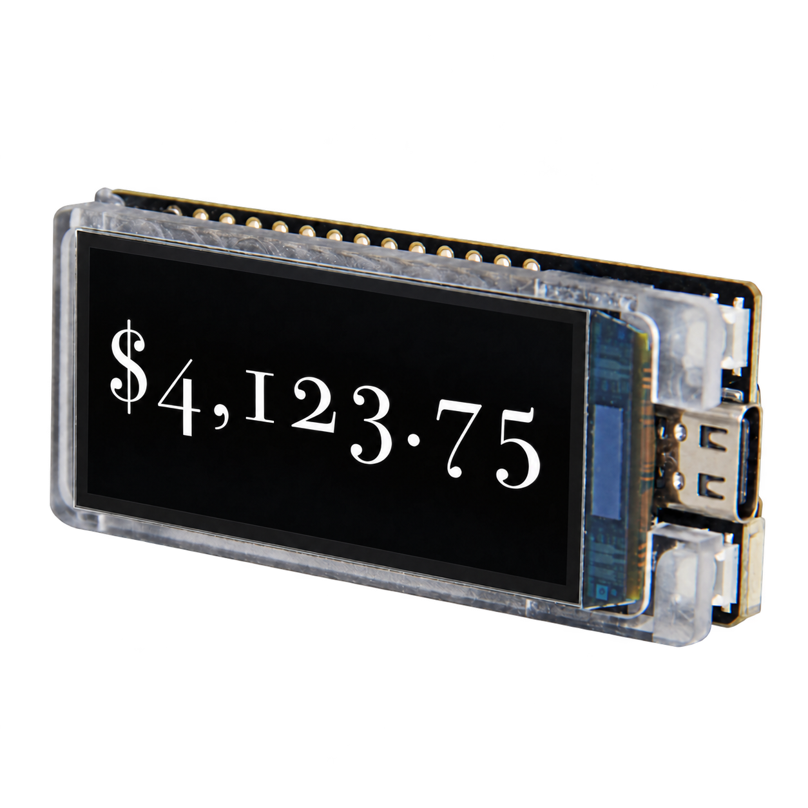

# Angst


A fun price ticker for the LilyGo T-Display-S3 AMOLED 1.91-inch display board.

## Features

* Large ticker.
* Matter over WiFi with BLE commissioning. Matter commissioning is how WiFi is configured on the
  device, so it is required.
* Simple HTTP admin UI.
* Optional LED lighting control via GPIO.
* Fun animations.


## Installation guide

You need a **[LilyGo T-Display-S3 AMOLED
1.91-inch](https://lilygo.cc/products/t-display-s3-amoled?variant=43506902335669)** board.

- **Already running Angst and connected to Wi-Fi?** [Update an existing Angst
  display](#update-an-existing-angst-display).
- **New board?** Start with [first installation](#first-installation).

### Update an existing Angst display

1. Download the [latest firmware
   (`angst-esp32s3.bin`)](https://github.com/retsyx/angst/releases/latest/download/angst-esp32s3.bin).
2. Open [http://angst.local/](http://angst.local/)
3. If you do not know the current password, select **Show password on display** and read it from the
   display.
4. Under **Firmware upgrade**, choose `angst-esp32s3.bin`, enter the current password, and select
   **Upload firmware**.
5. Keep power connected until the upload finishes and the display restarts, then reload the page.

### First installation

1. Download the [latest USB installation bundle
   (`angst-esp32s3-flash.zip`)](https://github.com/retsyx/angst/releases/latest/download/angst-esp32s3-flash.zip)
   and the [commissioner for your computer](#commissioner-downloads). Take all downloads from the
   same release. Extract both archives into the same parent folder.
2. Open a terminal in the extracted commissioner folder. Run the commissioner to create provisioning
   data in a folder of your choosing:

   **macOS/Linux:**

   ```sh
   ./angst-commissioner --out <device folder>
   ```

   **Windows PowerShell:**

   ```powershell
   .\angst-commissioner.exe --out <device folder>
   ```

   Use a separate output folder for each board. Running the same command again reuses its identity;
   do not add `--regenerate`.
3. Open a terminal in the extracted **`angst-esp32s3-flash`** folder and run the commands for your
   computer:

   **macOS/Linux:**

   ```sh
   python3 -m venv .venv
   .venv/bin/python -m pip install esptool==5.4.0
   .venv/bin/python flash_firmware.py --port <YOUR_PORT> --provisioning ../<device folder>/provisioning-nvs.bin
   ```

   Replace `YOUR_PORT` with the board's serial port, such as `/dev/cu.usbmodem...` on macOS or
   `/dev/ttyACM0` on Linux.

   **Windows PowerShell:**

   ```powershell
   py -m venv .venv
   .\.venv\Scripts\python -m pip install esptool==5.4.0
   .\.venv\Scripts\python flash_firmware.py --port <YOUR_PORT> --provisioning ..\<device folder>\provisioning-nvs.bin
   ```

   Replace `YOUR_PORT` with the board's port shown in Device Manager (for example, `COM3`). The helper checks the bundle files
   and checksums, installs the firmware and your board's identity, then restarts the display. It
   refuses to write if either protected storage area contains saved data and never erases flash
   automatically.

   **A new board with factory demo data:** if the helper refuses installation because storage is not
   erased, and this board has **never been provisioned with Angst**, explicitly clear the old data,
   then rerun the helper:

   ```sh
   .venv/bin/python -m esptool --chip esp32s3 --port <YOUR_PORT> erase-flash
   ```

   In Windows PowerShell, use:

   ```powershell
   .\.venv\Scripts\python -m esptool --chip esp32s3 --port <YOUR_PORT> erase-flash
   ```

   This erases all saved data.
4. Keep a private backup of **`<device folder>/`**, especially `identity.json`, `qrcode.png`, and
   `onboarding.txt`. These contain this board's original pairing credentials. Continue with [Wi-Fi
   and price setup](#matter-pairing-and-price-setup)

Later firmware updates use the browser; you do not need to generate or flash another identity.

### Matter pairing

1. Enable Bluetooth on your phone and open your Matter app's **Add accessory** or **Add device**
   flow. Scan **`<device folder>/qrcode.png`**, generated by the commissioner in
   [First installation](#first-installation), step 2. Use the output folder you chose for that
   command. Alternatively, enter the manual pairing code from
   `<device folder>/onboarding.txt`.
2. Complete pairing. The device appears as **Angst**, a dimmable
   light; its light controls adjust the display brightness. Your app may ask you to accept an
   uncertified accessory because this project uses test Matter certificates.

### Price URL setup

Open [http://angst.local/](http://angst.local/). Select **Show
password on display** and read the password from the physical screen. Under **Price updates**,
enter a URL that returns the price as text, such as `$4,123.75`, enter that password, and select
**Save price URL**. The display starts fetching prices. Until a URL is configured, it shows
**Angst**.

Saving an empty URL pauses price updates and keeps the current display text. Responses from a previous URL are discarded if the URL changes while a request is running. HTTP redirects are disabled.

### LED lighting configuration

By default GPIO pins 45 and 46 are assigned for external LED lighting.

The available GPIO pins are: 1, 10, 11, 12, 13, 14, 15, 16, 39, 40, 41, 42, 43, 44, 45, 46.

#### Wiring an LED to a GPIO

With power disconnected, wire **GPIO → 330 Ω series resistor → LED anode (+, usually the longer
leg)**, then connect the **cathode (−) to GND**. Use one resistor per LED; never connect an LED
directly to a GPIO. For LED strips or higher-current lighting, use a transistor/MOSFET driver and
an appropriate power supply.

### Password change

You can optionally replace the generated default password with your own password using **Change password**.


## Build and first installation

Use the following instructions for a custom local build.

Use **ESP-IDF 6.1**, a compatible **ESP-Matter** checkout with its submodules installed, and **Go
1.24 or later**. Activate both SDK environments:

```sh
source </path/to/esp-idf/export.sh>
source </path/to/esp-matter/export.sh>
```

The verified ESP-Matter commit is `59574f3fb62fddc690b4127fd3a4a43cfce4245e`, with connectedhomeip
`539342f32d5f4dc93761c2f9325afe29270068f1`.

From this folder:

```sh
idf.py set-target esp32s3
idf.py build
idf.py -p <YOUR_PORT> flash monitor
```

Replace `YOUR_PORT` with the board's serial port, such as `/dev/cu.usbmodem...` on macOS or
   `/dev/ttyACM0` on Linux.

Exit the monitor with Ctrl+].

Optionally use **Price display** in `menuconfig` to configure the polling interval and animation
duration. The polling interval is 30 seconds and animation duration is 5000 ms by default.

The display uses two 16-row DMA buffers, totaling **34,304 bytes** of internal SRAM. Wi-Fi/LwIP, the
NimBLE host, Matter, and TLS use PSRAM for compatible allocations, leaving internal SRAM for DMA,
the BLE controller, and task stacks. General allocations above 2048 bytes prefer PSRAM; 64 KiB stays
reserved for allocations that require internal memory.

### Commissioner downloads

| Platform | Intel/AMD (`amd64`) | ARM64 (`arm64`) |
| --- | --- | --- |
| Linux | [Download](https://github.com/retsyx/angst/releases/latest/download/angst-commissioner-linux-amd64.tar.gz) | [Download](https://github.com/retsyx/angst/releases/latest/download/angst-commissioner-linux-arm64.tar.gz) |
| macOS | [Download](https://github.com/retsyx/angst/releases/latest/download/angst-commissioner-darwin-amd64.tar.gz) | [Download for Apple Silicon](https://github.com/retsyx/angst/releases/latest/download/angst-commissioner-darwin-arm64.tar.gz) |
| Windows | [Download](https://github.com/retsyx/angst/releases/latest/download/angst-commissioner-windows-amd64.zip) | [Download](https://github.com/retsyx/angst/releases/latest/download/angst-commissioner-windows-arm64.zip) |

Extract the appropriate archive and run `angst-commissioner --help` (or `angst-commissioner.exe
--help` on Windows).

## Matter and brightness

The accessory appears as **Angst**, a **Dimmable Light** (device type `0x0101`) with On/Off and
Level Control. Brightness starts at **100%** on a new device. Matter's levels 1–254 map to the
RM67162 panel brightness register 1–255. External LEDs follow the same brightness using 5 kHz
hardware PWM on the configured lighting GPIOs (45 and 46 by default). On/Off turns the panel and
LEDs off or restores the selected dim level. Price fetching and rendering continue while the panel
is off. The last brightness and On/Off state survive reboot and OTA; changes to the level use
deferred flash writes. Identify commands briefly flash the panel and LEDs without changing the saved
brightness.

On the first build, CMake runs the commissioning generator automatically. It creates a new random
passcode, discriminator, salt, serial, rotating ID, and SPAKE2+ verifier, then writes these files
under **`generated/matter/`**:

- **`qrcode.png`**: scan it in your Matter controller's Add Accessory flow.
- **`onboarding.txt`**: the manual pairing code and QR payload.
- **`identity.json`**: the private host backup of initial credentials and accessory metadata.
- **`provisioning-nvs.bin`**: the private device identity image for the USB flash helper.
- **`matter_identity.h`** and **`matter_identity.cmake`**: build inputs.

The release commissioner produces the same files in the folder selected by `--out`. The USB helper
writes `provisioning-nvs.bin` to the application's NVS partition along with the common firmware. For
a fresh local source installation, first boot saves the embedded identity there before starting
Matter. This identity includes the discriminator, SPAKE2+ salt, verifier and iteration count, serial
number, rotating device ID, and vendor/product IDs. Subsequent boots always use the saved identity,
regardless of the identity embedded in an update. It survives OTA, reboot, Matter factory resets,
and removal of Matter fabrics. If an existing device's identity is missing, unreadable, or corrupt,
startup stops without substituting the identity embedded in the current firmware.

Default Basic Information is manufacturer **Angst**, product **Angst Display**, node label
**Angst**, firmware **2.0.0** (numeric version **2**), and hardware **T-Display-S3 AMOLED**
(revision **1**). To customize these or increment firmware versions while preserving pairing
credentials, run from this folder:

```sh
go -C tools/commissioning run -mod=vendor . --out ../../generated/matter \
  --vendor-name 'Angst' --product-name 'Angst Display' --node-label 'Angst' \
  --software-version 3 --software-version-string 3.0.0
idf.py build
```

The same firmware version is used by ESP-IDF's application descriptor and Matter's Basic Information
cluster. Existing controller-assigned names take precedence over a changed default node label. The
Go tool's QR dependency is vendored, so identity generation works offline. See [the generator's
options and tests](tools/commissioning/README.md).

Keep the generated folder private and backed up. Normal builds reuse it, including after deleting
`build/`; use a separate output folder for each physical device. To build with another identity
folder, pass its absolute path as `idf.py -D DISPLAY_MATTER_IDENTITY_DIR=/absolute/device/identity
build`. `--regenerate` replaces only the host-generated identity files. Neither flashing those files
in a new application nor a Matter factory reset replaces an identity already saved on the device. A
full flash erase destroys the saved identity and all settings; only an intentional fresh
provisioning can then adopt a new seed and matching pairing code.

## Hardware mapping

| Signal | GPIO |
| --- | --- |
| AMOLED power enable (V2 boards) | 38 |
| AMOLED reset | 17 |
| QSPI chip select | 6 |
| QSPI clock | 47 |
| QSPI data 0 / 1 / 2 / 3 | 18 / 7 / 48 / 5 |
| External LEDs (hardware PWM, configurable in web UI) | 45 / 46 by default |

